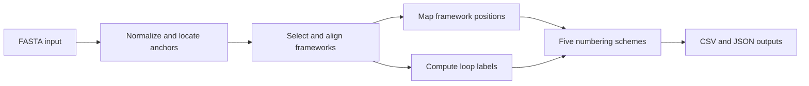

<h1 align="center">Antibody Numbering</h1>

<p align="center">
  <strong>Offline antibody variable-domain numbering in pure Python.</strong><br>
  From FASTA sequences to five standard numbering schemes, with residue-level mappings and traceable outputs.
</p>

<p align="center">
  <a href="#quick-start"></a>
  <a href="#how-it-works"></a>
  <a href="LICENSE"></a>
</p>

<p align="center">
  <a href="https://zhichao-chang.github.io/antibody-numbering/">Online tool</a> ·
  <a href="#quick-start">Quick start</a> ·
  <a href="#usage">Usage</a> ·
  <a href="#outputs">Outputs</a> ·
  <a href="#how-it-works">Method</a> ·
  <a href="#validation-and-scope">Validation</a>
</p>

---

Antibody Numbering assigns **Kabat, Chothia, IMGT, Martin, and AHo** positions to antibody variable-domain sequences. The implementation combines conserved-anchor detection, framework alignment, and explicit loop-numbering rules. It runs locally using the Python standard library and bundled public framework references.

| Capability | What you get |
| :--- | :--- |
| **Batch FASTA input** | Process heavy and light variable domains in a single file. |
| **Five numbering schemes** | Generate all five mappings in one invocation, including supported insertion labels. |
| **Residue traceability** | Retain input identifiers, original indices, normalized indices, and processing status. |
| **Offline execution** | Run on a CPU with no third-party Python packages, model downloads, or sequence submissions. |
| **Optional reference frequencies** | Annotate positions using bundled snapshots of public amino-acid counts. |

## Online tool

**[Open the browser application →](https://zhichao-chang.github.io/antibody-numbering/)**

Paste one or multiple FASTA records, select a record and scheme, and download the complete CSV or ZIP. Each record should contain one VH or VL variable domain. No installation or Python knowledge is needed.

The page runs the **same Python CLI and engine** in a browser Web Worker using self-hosted [Pyodide](https://pyodide.org/) 314.0.8. The initial runtime download is approximately 13 MB. All five schemes are computed locally; sequences are not submitted to a numbering service. Input and results live in page memory until cleared, replaced, or the tab is closed. Runtime and algorithm files are served as static GitHub Pages assets.

The browser uses the bundled default frameworks, with reference-frequency annotation disabled. CDRs are highlighted in all five views using explicit, selectable definitions. CSV downloads combine all records; ZIP downloads place each record in its own directory, with shared metadata at the top level. It preserves the command-line processing statuses and output files; run-specific paths and timestamps in the manifest reflect the browser filesystem. See [web/README.md](web/README.md) for deployment and verification details.

## Quick start

**Requirements:** Git and Python 3.10 or later. Run directly from a source checkout; no package installation is needed.

```bash
git clone https://github.com/ZhiChao-Chang/antibody-numbering.git
cd antibody-numbering

python3 -S scripts/number_antibodies_independent.py \
  --input examples/6vja_fv.fasta \
  --output results/example_001
```

The example contains the public rituximab VH and VL sequences from [PDB 6VJA](https://www.rcsb.org/structure/6VJA). It produces **10 sequence–scheme summaries** and **1,135 residue rows**. Open `results/example_001/numbering_with_frequencies.csv` for the mappings and `records_summary.csv` for per-sequence status.

Choose a **new output directory** for each run. The `-S` option disables third-party site-package loading; the tool only uses the standard library.

## Usage

### Number your sequences

```bash
python3 -S scripts/number_antibodies_independent.py \
  --input /path/to/antibodies.fasta \
  --output results/my_run
```

Use one antibody variable domain per FASTA record. Put VH and VL in separate records; both may be present in the same file. Record names are preserved and do not determine chain classification.

For complete antibody chains, extract the variable domain before numbering. General target proteins and concatenated multidomain constructs are outside the intended input scope.

### Command-line options

| Option | Required | Description |
| :--- | :---: | :--- |
| `--input PATH` | Yes | FASTA file containing one or more variable-domain sequences. |
| `--output PATH` | Yes | Output directory to create; must not already exist. |
| `--frameworks PATH` | No | Override the bundled framework JSON with a compatible reference asset. |
| `--frequency-cache PATH` | No | Add a local frequency-table directory. Repeat to search multiple directories in order. |
| `--help` | No | Display the command-line reference. |

The default framework file is resolved relative to the project, so it also works when the script is called by absolute path from another working directory:

```text
data/reference/independent_numbering_public_20261109/framework_templates.json
```

### Add amino-acid reference frequencies

```bash
python3 -S scripts/number_antibodies_independent.py \
  --input examples/6vja_fv.fasta \
  --output results/example_with_frequencies \
  --frequency-cache data/reference/abysis_frequencies_all_20261105 \
  --frequency-cache data/reference/independent_numbering_frequencies_20261109
```

`frequency_percent` is the observed amino-acid count divided by the reference total, including gaps, multiplied by 100. The bundled tables use the **All** organism category. They are fixed snapshots with partial position coverage; missing references and unknown residues receive a blank frequency and an explicit status. No tables are fetched during inference.

**Reference frequency is not a probability that a numbering assignment is correct.** Omitting the cache options leaves frequencies blank and still produces numbering results.

## Outputs

Each run writes six files:

| File | Purpose |
| :--- | :--- |
| `numbering_with_frequencies.csv` | Residue-level mappings for every sequence and scheme, with optional reference frequencies. |
| `records_summary.csv` | Processing status and mapped-residue count for each sequence–scheme pair. |
| `backend_outputs.json` | Full mappings, framework selection, inferred segments, and compatibility notes. |
| `input_ledger.json` | Original sequences, normalized sequences, and source-index mappings. |
| `manifest.json` | Input, source-code, and reference hashes; run statistics and frequency provenance. |
| `missing_frequency_positions.json` | Positions without a matching frequency reference. |

Selected columns from the public example:

```csv
header,scheme,chain_type,raw_index,input_residue,position,status
public_6VJA_H,kabat,H,1,Q,H1,numbered
public_6VJA_H,kabat,H,2,V,H2,numbered
public_6VJA_H,kabat,H,3,Q,H3,numbered
```

`raw_index` and `normalized_index` are **1-based**. Preserve `position` as a string: labels can include prefixes, letters, and decimal insertions, such as `H35A` and `H112.1`. The full CSV also includes the original header, normalized residue, frequency status, and reference path.

<details>
<summary><strong>Input normalization and status interpretation</strong></summary>

- Sequences are normalized to uppercase. Alignment gaps (`-`) are removed, and `?` is represented as the unknown residue `X`; original indices remain available.
- Records containing `*`, invalid characters, or an empty sequence are skipped with a reason in the ledger and summary.
- `unclassified` means no acceptable framework interpretation was found.
- `unsupported` means a scheme encountered a case beyond the implemented rules; details are recorded in `backend_outputs.json`.
- `unmapped_position` identifies residues without an assigned standard position.
- `numbered` records completion under the implemented rules. It does not certify correctness or guarantee that every residue received a label.

Malformed FASTA structure, such as sequence text before the first header, is rejected. Check the per-scheme results and compatibility notes when interpreting partial outputs.

</details>

## How it works



1. **Locate and score framework hypotheses.** Search heavy-, kappa-, and lambda-chain interpretations using conserved-anchor evidence, supported segment lengths, and framework similarity.
2. **Match a curated framework library.** Five masked base frameworks are complemented by **152 public framework fragments**: 80 FR1, 24 FR2, 32 FR3, and 16 FR4 fragments. Candidate FR4 windows are scored beyond their first motif.
3. **Generate framework coordinates.** Align supported framework segments, apply chain/length-specific FR3 paths, and convert **38 framework coordinate paths** across the five schemes.
4. **Compute loop labels and export.** Explicit chain/subtype/length rules assign loop positions and insertion labels. The CLI preserves input coordinates, statuses, hashes, and optional frequency annotations.

Framework fragments and coordinate labels were curated from opened public SAbDab2/OAS examples with cached abYsis mappings. Runtime inference uses the bundled library and locally implemented rules; it does not call ANARCI/ANARCII, HMMER, neural weights, network services, or a whole-query answer cache. No neural training is required. Reference-library construction and heuristic thresholds were calibrated during development.

Internal scores rank candidate interpretations; they are not correctness probabilities. Internal loop spans may include flanking residues, while browser CDR colors follow the independently selected CDR definition.

See the [implementation guide](docs/algorithm.md), [validation record](docs/validation.md), and annotated [core engine](src/antibody_numbering/engine.py).

## Python integration

The core engine can also be called from a Python process. Run this example from the repository root:

```python
import sys
from pathlib import Path

sys.path.insert(0, str(Path("src").resolve()))
from antibody_numbering import AnchorNumberer

numberer = AnchorNumberer(
    Path("data/reference/independent_numbering_public_20261109/framework_templates.json")
)

# Public rituximab VH sequence from PDB 6VJA.
sequence = (
    "QVQLQQPGAELVKPGASVKMSCKASGYTFTSYNMHWVKQTPGRGLEWIGAIYPGNGDTSYN"
    "QKFKGKATLTADKSSSTAYMQLSSLTSEDSAVYYCARSTYYGGDWYFNVWGAGTTVTVSA"
)
result = numberer.number(sequence)

print(result["chain"])                       # H
print(result["schemes"]["imgt"]["positions"])  # One label per input residue; unmapped entries are blank.
```

The engine returns dictionaries of per-scheme results. For arbitrary inputs, inspect the overall and per-scheme status before accessing mappings; unclassified results have a different shape. Use the CLI for batch FASTA parsing, input normalization records, and frequency annotation.

## Validation and scope

Run the bundled test suite without additional dependencies:

```bash
python3 -B -S -m unittest discover -s tests -v
```

The current suite contains **33 tests** covering framework indels, false FR4-like motifs inside CDR3, short loops, aromatic anchor variants, terminal truncation, unknown residues, negative controls, exact packed scoring, offline inference, frequency arithmetic, CLI overrides, CDR-region projection, and per-sequence ZIP exports.

| Fixed abYsis comparison | Kabat | Chothia | IMGT | Martin | AHo |
| :--- | ---: | ---: | ---: | ---: | ---: |
| Representative: reference-numbered inputs | 197/197 | 197/197 | 197/197 | 197/197 | 197/197 |
| Enriched difficult: reference-numbered inputs | 91/95 | 91/95 | 91/95 | 91/95 | 89/95 |

These are **development compatibility results on opened fixed sets**. The representative set contains 200 inputs (3 unnumbered by the reference); the difficult set contains 100 (5 unnumbered). Reference-unclassified inputs are tracked separately. These cohorts informed library/rule development and are not an untouched accuracy estimate.

All 184 original regression records retain their numbering/rejection behavior. Corrected negative controls (1,000 records) receive no numbering. An additional 12,500-input engineering/peer audit completed without runtime errors. Detailed denominators, coverage differences, auxiliary-tool results, and reproducibility hashes are in [validation.md](docs/validation.md) and [validation_summary.json](docs/validation_summary.json).

**Current scope:** one antibody variable domain per record, within the supported framework and loop-length rules. Rare scaffolds such as shark VNAR, extreme loops, unusual indels, and multidomain constructs remain coverage limits.

For supported heavy second-segment lengths >=19, a verified legacy abYsis AHo conversion returns a partial mapping. This compatibility behavior is retained with explicit `compatibility_notes` and blank suffix positions.

## Repository layout

```text
antibody-numbering/
├── scripts/number_antibodies_independent.py   # Batch CLI
├── src/antibody_numbering/                   # Core engine
├── data/reference/                          # Frameworks and optional frequency tables
├── examples/6vja_fv.fasta                    # Public VH/VL example
├── tests/                                   # Unit and CLI tests
└── docs/provenance.json                     # SHA-256 inventory of the initial import
```

Run manifests describe the assets used in each invocation. The provenance inventory records the initial imported bytes and is not a live checksum manifest for subsequent source edits. Generated results and local input directories are excluded by `.gitignore`.

## Contributing

[Open an issue](https://github.com/ZhiChao-Chang/antibody-numbering/issues) with the command, Python version, commit identifier, observed behavior, and expected result. Use a minimal public or synthetic sequence when sharing a reproducer. For numbering-rule changes, include the scheme, a traceable reference assignment, and a regression test.

## Reference data and license

Framework sources: [6VJA](https://www.rcsb.org/structure/6VJA), [6XDG](https://www.rcsb.org/structure/6XDG), [1N8Z](https://www.rcsb.org/structure/1N8Z), and [2VIR](https://www.rcsb.org/structure/2VIR). Optional position-frequency snapshots originate from [abYsis](http://www.abysis.org/abysis/); each table retains its source URL, retrieval timestamp, counts, and response hash.

The [reference-data guide](data/reference/README.md) documents the framework schema, table fields, and source provenance.

The original source code is available under the [MIT License](LICENSE). Public structures and third-party reference data retain their original attribution and applicable rights; the code license does not relicense those materials.
